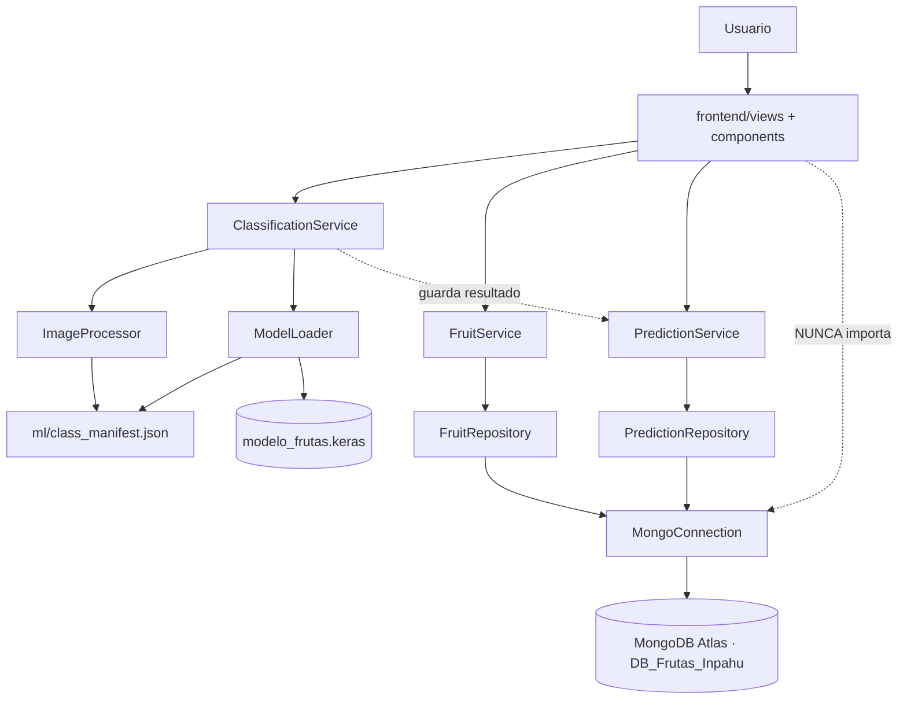

# Arquitectura

## Árbol del proyecto

```
proyecto-cnn-frutas/
├── app.py                        # entrypoint delgado; delega en frontend/
├── modelo_frutas.keras           # PROTEGIDO: sin cambios
├── Proyecto_Final_CNN_Clasificacion_Frutas.ipynb  # PROTEGIDO: sin cambios
├── frontend/                     # vistas y componentes Streamlit
├── backend/                      # servicios, repositorios, modelos, config, DB
├── ml/                           # manifiesto, procesado de imágenes, carga del modelo
├── scripts/                      # versiones corregidas de train.py/predict.py y comprobación de conexión
├── tests/                        # pruebas unitarias y de integración
├── docs/                         # documentación operativa
├── .env.example                  # plantilla sin credenciales
├── .gitignore
├── .gitattributes
├── pytest.ini
├── requirements.txt
├── README.md
└── CHANGELOG.md
```

## Diagrama de capas



Regla de dependencias: `frontend` → `backend/services` → `backend/repositories` → `backend/database` → Atlas; `backend/services` → `ml` → manifiesto/modelo. Las vistas **nunca importan `pymongo` ni `backend.database`**.

## Flujo de reconocimiento

1. La vista recibe el archivo de imagen.
2. `ImageProcessor` valida extensión (JPG/JPEG/PNG, ≤ 5 MB) y preprocesa: RGB → 100×100 → `float32` → `(1, 100, 100, 3)`, **sin dividir entre 255**.
3. `ModelLoader` carga `modelo_frutas.keras` (caché) y valida que sus salidas coincidan con el manifiesto.
4. `ClassificationService` predice, devuelve fruta, confianza y probabilidades, e intenta guardar en el historial. Si Atlas falla, la predicción se muestra igual con un aviso.

## Modelo de datos

Ver `docs/base_datos.md`: colecciones `fruits` y `predictions`, cinco campos por documento, índices y ausencia de imágenes binarias.

## Decisiones de diseño relevantes

- Único punto de entrada: `app.py` (refactorizado como delegado a `frontend/`); protegido con tag `git tag pre-refactor` y línea base de regresión.
- Manifiesto como única fuente de clases: `ml/class_manifest.json` con `name`, `scientific_name` y `description`.
- Índice único de `fruits.name` con collation `strength: 2` (sin campo auxiliar de normalización).
- PyMongo directo; pruebas unitarias con `mongomock` y dobles; integración solo contra `DB_Frutas_Inpahu_test`.
