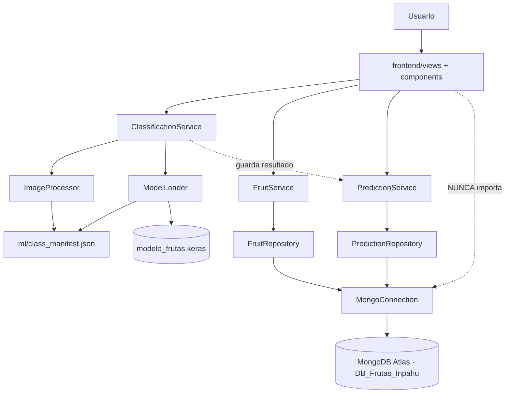

# Design

## Context

El repositorio contiene una aplicación Streamlit de un solo archivo (`app.py`, 63 líneas), un modelo Keras de 20 MB en la raíz, un notebook de Kaggle y dos scripts (`train.py`, `predict.py`) que empiezan y terminan con cercas de Markdown, por lo que no son ejecutables. No existen `backend/`, `scripts/`, `tests/`, `docs/`, `.env.example`, specs previas ni código de conexión a bases de datos que reutilizar. La motivación completa y la auditoría están en `proposal.md`; los comportamientos exigidos están en `specs/`.

Restricciones que condicionan el diseño: el modelo no se reentrena ni se mueve; `app.py`, `train.py`, `predict.py`, el notebook, `modelo_frutas.keras` y `README.md` se conservan como archivos (sin borrado, renombrado, movimiento ni reemplazo destructivo); ningún artefacto contiene credenciales reales; la salida debe ser idéntica a la de `app.py`.

Decisiones ya confirmadas por el solicitante: `app.py` será el único punto de entrada (sin `streamlit_app.py`); antes del refactor se creará el tag `pre-refactor` y se capturará una línea base de regresión con imágenes de referencia; el cluster de Atlas existe y hay acceso; el manifiesto contendrá también nombre científico y descripción para las cinco clases; el modelo y el notebook se quedan en la raíz y su traslado se delega a un cambio posterior.

## Goals / Non-Goals

**Goals:**
- Separar interfaz, servicios, repositorios, acceso a datos y machine learning con dependencias unidireccionales.
- Centralizar clases, configuración y errores de dominio en un solo lugar por responsabilidad.
- Persistir catálogo e historial en Atlas con un modelo de datos de cinco campos por documento.
- Mantener la paridad funcional exacta del pipeline de imagen y de la predicción, verificada contra una línea base anterior al refactor.
- Mantener un único punto de entrada (`app.py`) y una sola fuente de verdad para clases y metadatos.
- Dejar una base de pruebas automatizadas y documentación operativa.

**Non-Goals:**
- Reentrenar, mover o sustituir el modelo; reconocer más de las cinco clases entrenadas.
- Limpiar el notebook ni descargar datasets de Kaggle.
- Aprovisionar el cluster de Atlas (ya existe y hay acceso) ni escribir su URI real.
- Añadir autenticación de usuarios, API HTTP, despliegue o migraciones automáticas de datos de producción.

## Árbol definitivo

```text
proyecto-cnn-frutas/
├── app.py                                   # entrypoint delgado; delega en frontend/
├── modelo_frutas.keras                      # PROTEGIDO: sin cambios
├── Proyecto_Final_CNN_Clasificacion_Frutas.ipynb  # PROTEGIDO: sin cambios
├── frontend/
│   ├── __init__.py
│   ├── navigation.py                        # selección de las cinco secciones
│   ├── components/
│   │   ├── __init__.py
│   │   ├── image_uploader.py
│   │   ├── prediction_card.py
│   │   └── confirm_dialog.py
│   └── views/
│       ├── __init__.py
│       ├── inicio.py
│       ├── reconocimiento.py
│       ├── historial.py
│       ├── administracion_frutas.py
│       └── estadisticas.py
├── backend/
│   ├── __init__.py
│   ├── config/
│   │   ├── __init__.py
│   │   └── settings.py                      # Settings
│   ├── database/
│   │   ├── __init__.py
│   │   ├── mongo_connection.py              # MongoConnection
│   │   └── indexes.py                       # creación centralizada de índices
│   ├── models/
│   │   ├── __init__.py
│   │   ├── exceptions.py                    # excepciones de dominio
│   │   ├── fruit.py                         # Fruit
│   │   └── prediction.py                    # Prediction
│   ├── repositories/
│   │   ├── __init__.py
│   │   ├── fruit_repository.py              # FruitRepository
│   │   └── prediction_repository.py         # PredictionRepository
│   └── services/
│       ├── __init__.py
│       ├── fruit_service.py                 # FruitService
│       ├── prediction_service.py            # PredictionService
│       └── classification_service.py        # ClassificationService
├── ml/
│   ├── __init__.py
│   ├── class_manifest.json                  # única fuente de las cinco clases
│   ├── class_manifest.py                    # lectura y validación del manifiesto
│   ├── image_processor.py                   # ImageProcessor
│   └── model_loader.py                      # ModelLoader
├── scripts/
│   ├── check_mongo_connection.py
│   ├── train.py                             # versión corregida; original intacto
│   └── predict.py                           # versión corregida; original intacto
├── tests/
│   ├── conftest.py                          # dobles, mongomock y fixtures
│   ├── unit/
│   │   ├── test_settings.py
│   │   ├── test_mongo_connection.py
│   │   ├── test_fruit_repository.py
│   │   ├── test_prediction_repository.py
│   │   ├── test_fruit_service.py
│   │   ├── test_image_processor.py
│   │   ├── test_model_loader.py
│   │   ├── test_classification_service.py
│   │   └── test_regression_app.py
│   └── integration/
│       ├── test_fruit_crud_integration.py
│       └── test_prediction_crud_integration.py
├── docs/
│   ├── requisitos.md
│   ├── arquitectura.md
│   ├── base_datos.md
│   ├── conexion_mongodb.md
│   └── pruebas.md
├── openspec/                                # root OpenSpec existente
├── .env.example
├── .gitignore
├── .gitattributes
├── pytest.ini
├── requirements.txt
├── README.md
└── CHANGELOG.md
```

Justificación de las adiciones respecto al árbol base propuesto:
- `ml/class_manifest.py`: evita que cada módulo interprete el JSON por su cuenta; el manifiesto sigue siendo la única fuente de clases.
- `backend/database/indexes.py`: concentra los índices (unicidad con collation e índice descendente de fecha) para que no se definan en dos repositorios.
- `backend/models/exceptions.py`: mantiene las excepciones de dominio en un único módulo sin dependencias de frameworks.
- `frontend/navigation.py`: implementa las cinco secciones sin repetir la lógica de menú en cada vista.
- `tests/unit/` y `tests/integration/`: permiten excluir la integración de la ejecución por defecto.
- `pytest.ini`: registra el marcador `integration` y evita advertencias de marcador desconocido.
- El modelo y el notebook **permanecen en la raíz**; `MODEL_PATH` apunta a `modelo_frutas.keras`. No se crean `models/` ni `notebooks/` sin aprobación.

## Diagrama de flujo entre capas



Regla de dependencias: `frontend` → `backend/services` → `backend/repositories` → `backend/database` → Atlas; `backend/services` → `ml` → manifiesto/modelo. Está prohibido importar desde una capa superior o importar `pymongo` en `frontend`.

## Tabla de clases y responsabilidades

| Clase | Atributos | Métodos públicos | Excepciones | Inyección de dependencias |
| --- | --- | --- | --- | --- |
| `Settings` | `mongodb_uri`, `database`, `fruits_collection`, `predictions_collection`, `timeout_ms`, `model_path`, `manifest_path` | `from_env()`, `validate()` | `ValidationError`, `MongoConfigurationError` | Mapa de entorno inyectable para pruebas |
| `MongoConnection` | `settings`, `client`, `database` | `connect()`, `ping()`, `get_collection(name)`, `close()` | `MongoConnectionError` y subtipos | `Settings` |
| `Fruit` | `id`, `name`, `scientific_name`, `description`, `active` | `from_document()`, `to_document()`, `set_active()`, `validate()` | `ValidationError` | Ninguna; `_id` opcional de tipo ObjectId |
| `Prediction` | `id`, `fruit_name`, `confidence`, `image_name`, `created_at` | `from_document()`, `to_document()`, `change_fruit_name()`, `validate()` | `ValidationError` | Ninguna; `created_at` UTC |
| `FruitRepository` | `collection` | `create()`, `list_all(active_only)`, `get_by_id()`, `update()`, `set_active()`, `delete()`, `seed_from_manifest()` | `DuplicateFruitError`, `NotFoundError` | Colección obtenida de `MongoConnection` |
| `PredictionRepository` | `collection` | `create()`, `list_sorted(fruit, date_from, date_to)`, `get_by_id()`, `update_fruit_name()`, `delete()` | `NotFoundError`, `ValidationError` | Colección obtenida de `MongoConnection` |
| `FruitService` | `repository`, `manifest` | `create()`, `list()`, `get()`, `update()`, `activate()`, `deactivate()`, `delete()`, `seed_catalog()` | `ValidationError`, `DuplicateFruitError`, `NotFoundError` | `FruitRepository` y lector de manifiesto |
| `PredictionService` | `repository` | `register()`, `list()`, `get()`, `correct_fruit_name()`, `delete()` | `ValidationError`, `NotFoundError` | `PredictionRepository` |
| `ClassificationService` | `model_loader`, `image_processor`, `manifest`, `prediction_service`, `model` (caché) | `classify(bytes, image_name, persist=True)`, `probabilities()` | `InvalidImageError`, `ModelMismatchError` | Los cuatro colaboradores; devuelve un resultado con `saved` y `warning` |
| `ImageProcessor` | `allowed_types`, `max_bytes`, `target_size` | `validate(file)`, `process(file)`, `display_ready(file)` | `InvalidImageError` | Opcionalmente `Settings` para límites |
| `ModelLoader` | `settings`, `manifest`, `model` | `load()`, `get_model()`, `validate_compatibility()`, `class_names()` | `ModelMismatchError` | `Settings` y lector de manifiesto |

Excepciones de dominio (todas en `backend/models/exceptions.py`): `ValidationError`, `DuplicateFruitError`, `NotFoundError`, `InvalidImageError`, `ModelMismatchError`, `MongoConnectionError` y los subtipos `MongoConfigurationError`, `MongoAuthenticationError`, `MongoPermissionError`, `MongoNetworkError`. La interfaz traduce estas excepciones a mensajes de usuario; nunca muestra la URI ni trazas con secretos.

`ClassificationService.classify()` devuelve una estructura de resultado interna con `fruit_name`, `confidence`, `probabilities`, `saved` y `warning`. No es una nueva entidad de dominio: solo evita que un fallo de Atlas destruya una predicción ya calculada.

## Modelo de datos

Base principal: `DB_Frutas_Inpahu`. Base de pruebas de integración: `DB_Frutas_Inpahu_test`. Nombres por defecto: `fruits` y `predictions`.

| Colección | Campo | Tipo | Restricción |
| --- | --- | --- | --- |
| `fruits` | `_id` | ObjectId | Generado por MongoDB; sin contadores |
| `fruits` | `name` | String | Único sin distinguir mayúsculas; índice único con collation `strength: 2` |
| `fruits` | `scientific_name` | String | Obligatorio no vacío en altas manuales |
| `fruits` | `description` | String | Texto libre |
| `fruits` | `active` | Boolean | `true` por defecto |
| `predictions` | `_id` | ObjectId | Generado por MongoDB |
| `predictions` | `fruit_name` | String | Nombre de la clase predicha |
| `predictions` | `confidence` | Double | 0-100 |
| `predictions` | `image_name` | String | Solo el nombre del archivo; nunca el binario |
| `predictions` | `created_at` | Date | UTC; índice descendente |

Cinco campos exactos por documento, contando `_id`. No se almacenan imágenes ni contadores autoincrementales. No se crea un campo auxiliar en minúsculas: la unicidad insensible a mayúsculas se resuelve con collation en el índice, para respetar el límite de campos.

Contenido previsto de `.env.example` (sin credenciales reales):

```dotenv
MONGODB_URI=REEMPLAZAR_POR_URI_DE_ATLAS
MONGODB_DATABASE=DB_Frutas_Inpahu
MONGODB_FRUITS_COLLECTION=fruits
MONGODB_PREDICTIONS_COLLECTION=predictions
MONGODB_TIMEOUT_MS=8000
MODEL_PATH=modelo_frutas.keras
```

## Decisiones

1. **Monolito modular en capas, no microservicios.** Un solo proceso Streamlit con paquetes bien delimitados reduce la complejidad operativa y permite inyectar dobles en pruebas. Alternativa descartada: separar un servicio HTTP para predicciones (añadiría despliegue y latencia sin beneficio para el alcance).
2. **PyMongo directo, sin ODM.** Da control total sobre los cinco campos, los índices y la collation, y evita dependencias adicionales. Alternativa descartada: Beanie/MongoEngine, que imponen metadatos y esquemas que complican el límite de campos.
3. **Manifiesto JSON como única fuente de clases, con lector propio.** `ml/class_manifest.json` conserva el orden de salida del modelo. Alternativa descartada: mantener la lista en cada módulo, que es la causa actual de divergencias.
4. **Sin normalización manual de la imagen.** Se replica `Image.open(...).convert("RGB")` → `resize((100,100))` → `float32` → `expand_dims` de `app.py`. El modelo incluye `Rescaling`, así que dividir entre 255 duplicaría la normalización.
5. **Caché del modelo en una sola capa.** `ModelLoader` mantiene la instancia cargada y la vista usa el mecanismo de caché de Streamlit en el entrypoint. Alternativa descartada: cargar el modelo en cada predicción (20 MB por petición).
6. **Unicidad por collation, no por campo extra.** Permite `name` único ignorando mayúsculas sin superar cinco campos. Alternativa descartada: un campo `name_normalized` (rompería el límite).
7. **Persistencia tolerante a fallos.** `ClassificationService` intenta guardar y captura `MongoConnectionError`; la vista muestra la predicción con un aviso. Alternativa descartada: abortar la predicción si Atlas cae (rompería la función principal).
8. **Un único `app.py` delgado, protegido por tag y línea base.** Se interpreta «no sobrescribir» como «no reemplazar de forma destructiva»: el archivo permanece y delega en `frontend/`, manteniendo `streamlit run app.py`. Antes del refactor se crea el tag `git tag pre-refactor` (sin commits) y se capturan clase y confianza de imágenes de referencia con la versión heredada; la regresión se ejecuta contra esa línea base y de nuevo tras el cambio. Alternativa descartada: crear `streamlit_app.py`, porque dejaría dos puntos de entrada que se desincronizan y mantendría duplicada la lista de clases. Los originales `train.py` y `predict.py` siguen intactos en la raíz; las versiones corregidas viven en `scripts/`.
9. **Pruebas unitarias con dobles/`mongomock`; integración marcada.** Ninguna prueba unitaria abre conexión de red. Alternativa descartada: usar la base de desarrollo en todas las pruebas.
10. **`.gitattributes` con normalización de fin de línea.** El árbol está limpio hoy, pero `core.autocrlf=true` sin `.gitattributes` deja el diff expuesto a CRLF/LF.
11. **Manifiesto con metadatos de las cinco clases.** `ml/class_manifest.json` incluye `name`, `scientific_name` y `description` en orden de salida; es la única fuente para el modelo, el entrenamiento, la predicción y la siembra de Atlas. La interfaz lee el catálogo ya sembrado y permite ajustar descripciones en Atlas sin editar código ni el manifiesto. Alternativa descartada: dejar los metadatos vacíos y completarlos a mano, que rompería la fuente única de verdad.
12. **Atlas existente, sin aprovisionamiento en este cambio.** El solicitante confirmó que el cluster y el acceso existen; se usa la URI configurada fuera del repositorio y se valida la conexión antes de crear índices o sembrar. Alternativa descartada: asumir un cluster nuevo o guardar la URI en el repositorio.

## Risks / Trade-offs

- [Deriva de la predicción] → Prueba de regresión obligatoria contra `app.py` con una imagen fija; cualquier cambio en `ImageProcessor` exige ejecutarla.
- [Desajuste manifiesto/modelo] → `ModelLoader.validate_compatibility()` lanza `ModelMismatchError` antes de cualquier predicción.
- [Credenciales filtradas] → `.gitignore` ampliado, `.env.example` con marcador, mensajes de error sin URI y advertencia sobre el notebook (sin reproducir sus valores).
- [Atlas caído] → Resultado visible con aviso; los servicios de catálogo informan el error en lugar de dejar la interfaz en blanco.
- [Duplicados por case] → Índice único con collation y validación previa en el repositorio.
- [Ruido CRLF/LF] → `.gitattributes` y una sola pasada de normalización controlada.
- [Puntos de entrada duplicados] → Un solo `app.py`, tag `pre-refactor` y línea base de regresión antes del refactor.
- [Pérdida de la versión heredada] → El tag `pre-refactor` permite recuperar `app.py` en un comando sin commits ni reescritura de historial.
- [Descripción editada en Atlas distinta del manifiesto] → El manifiesto es fuente de verdad solo para la siembra inicial; los ajustes posteriores se hacen desde la interfaz y se documentan como datos de Atlas, sin cambiar código.
- [Coste de dependencias nuevas] → Cuatro paquetes adicionales (`pymongo`, `python-dotenv`, `pytest`, `mongomock`) con versiones fijadas en `requirements.txt`.

## Plan de migración y reversión

0. **Línea base y tag, antes de tocar código:** crear `git tag pre-refactor` (sin commits) y registrar clase y confianza de `app.py` para un conjunto de imágenes de referencia; ejecutar la prueba de regresión contra esa línea base.
1. **Preparación:** usar la URI del cluster existente con permisos de lectura/escritura; no se guarda en Git. Verificar la conexión con `scripts/check_mongo_connection.py` una vez creado el script.
2. **Instalación:** ampliar `requirements.txt`, crear `.env` local ignorado a partir de `.env.example` y aplicar `.gitattributes`.
3. **Estructura:** crear los paquetes y el manifiesto sin tocar los archivos protegidos; mantener `app.py` funcionando hasta que el nuevo entrypoint esté listo.
4. **Datos:** crear índices, exportar una copia de seguridad de las colecciones antes de cualquier siembra y ejecutar la siembra idempotente desde el manifiesto (nombre, nombre científico y descripción). La siembra nunca sobrescribe nombres existentes.
5. **Corte:** sustituir el cuerpo de `app.py` por el delegado a `frontend/` y verificar la prueba de regresión y las cinco secciones.
6. **Verificación:** ejecutar pruebas unitarias, luego las de integración contra `DB_Frutas_Inpahu_test`, y revisar que no haya secretos en el diff.
7. **Reversión:** recuperar `app.py` desde el tag con `git checkout pre-refactor -- app.py` y restaurar los demás archivos modificados desde el control de versiones, sin commits ni reescritura de historial; conservar la copia de seguridad de las colecciones. No se eliminan datos de producción sin aprobación expresa. El modelo y el notebook nunca participan en la reversión.

## Supuestos

- «No eliminar, renombrar, mover ni sobrescribir» significa conservar la identidad y el contenido protegido frente a reemplazos destructivos; se permite la refundición controlada de `app.py` como entrypoint y la ampliación incremental de `README.md`.
- Python 3.11 o compatible, según el README actual.
- El cluster de Atlas existe y hay acceso; la URI se entrega fuera del repositorio y este cambio solo define la plantilla con `REEMPLAZAR_POR_URI_DE_ATLAS`.
- El manifiesto incluye `scientific_name` y `description` para las cinco clases; son la fuente de la siembra inicial y no se inventan valores.
- No se crea `streamlit_app.py`: `app.py` es el único punto de entrada, protegido por el tag `pre-refactor` y por la línea base de regresión.
- El catálogo puede contener frutas que el modelo actual no clasifica; el sistema nunca afirma reconocerlas.
- La interfaz se ejecuta con `python -m streamlit run app.py`, conservando el comando documentado.

## Preguntas abiertas

Ninguna pendiente: el solicitante confirmó las cuatro decisiones (único `app.py` delgado, cluster de Atlas disponible, metadatos en el manifiesto y traslado diferido).

Cambio posterior, fuera de este alcance: mover `modelo_frutas.keras` a `models/` y el notebook a `notebooks/` una vez que las pruebas pasen. Cualquier reentrenamiento para nuevas clases también se trata por separado.
